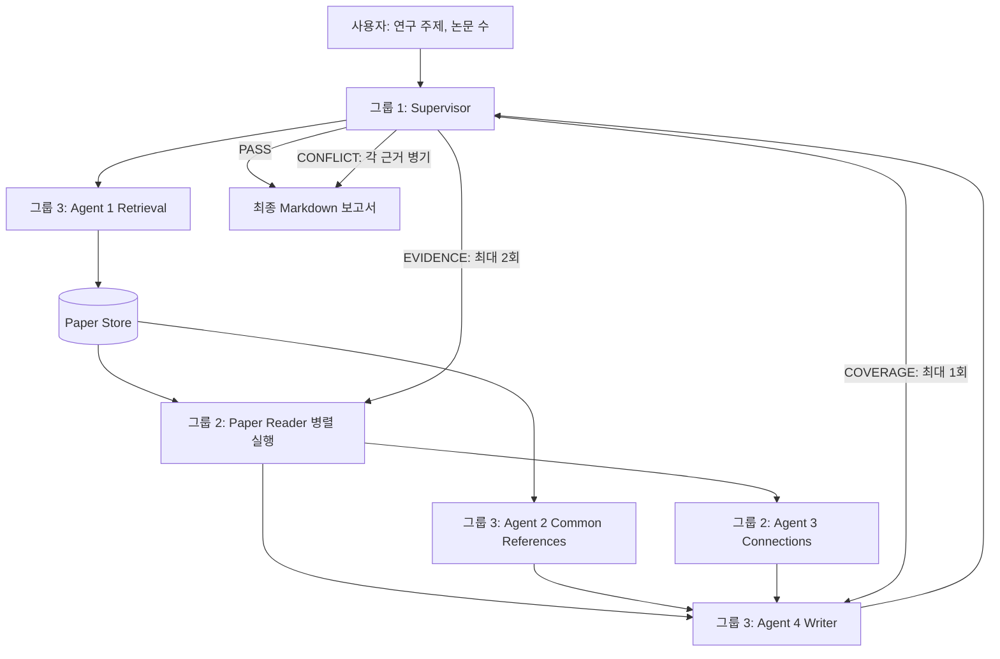

# 그룹 3 — Multi-Agent 논문 분석·보고서 자동화 시스템 개발 가이드

> **문서 상태:** 그룹 3 내부 설계 기준안 (2026-11-03)  
> **담당 범위:** Agent 1 — Retrieval / Agent 2 — Common References / Agent 4 — Writer  
> **기초 자료:** `Tasks.pdf`(1~2쪽), `Workflow .pptx`(슬라이드 1~3 및 발표자 노트)  
> **추가 반영:** 대화에서 합의된 논문 선정 수·선정 우선순위·Markdown 출력 형식 및 구현 권장안

---

## 0. 문서를 읽는 방법: 확정 사항과 제안 구분

이 문서는 원본 자료의 과제 요구사항에 사용자가 확정한 설계 결정을 반영하고, 실제 개발에 필요한 구현 제안을 추가한 것이다. 아직 다른 그룹과 합의하지 않은 내용을 **팀 전체 확정 사항으로 간주하지 않는다.**

- **[원본 요구]**: 제공된 PDF/PPTX에 명시된 요구사항
- **[확정]**: 이번 대화에서 그룹 3의 기준으로 확정한 사항
- **[권장 구현]**: 코드를 만들기 위한 권장 설계. 통합 시 조정 가능
- **[팀 협의]**: 그룹 1·2와 반드시 맞춰야 할 인터페이스·저장소·정책

### 0.1 결정 사항 요약

| 항목 | 결정/원칙 | 상태 |
|---|---|---|
| 담당 Agent | Agent 1, Agent 2, Agent 4 | [원본 요구] |
| 선정 논문 수 | **기본 7~8편**; 목표 8편, 7편도 허용; 변경 가능한 설정값 | [확정] + 세부 운영은 [권장 구현] |
| 논문 선정 1순위 | **연구 주제와의 관련성** | [확정] |
| 논문 선정 2순위 | **최신성** | [확정] |
| 추가 적격성 검사 | 중복 제거, 원문 접근 및 본문 파싱 가능성 확인 | [권장 구현] |
| 보고서 출력 | **Markdown (`.md`)** | [확정] |
| 공통 참고문헌 | 선정 논문 중 **2편 이상에서 인용**된 참고문헌 | [원본 요구] |
| 공통 참고문헌 순위 | 선정 논문 집합 내부의 **서로 다른 인용 논문 수**로 정렬 | [권장 구현], [팀 협의] 확인 |
| 데이터 검증 | 팀 공통 Pydantic 스키마 | [권장 구현], [팀 협의] 필요 |
| 에이전트 간 통신 | A2A, 그룹 1과 호환되는 인터페이스·버전 | [원본 요구] + [팀 협의] |
| Paper Store | 그룹 2 Reader가 읽을 수 있는 공용 저장소 | [원본 요구] + [팀 협의] |
| Agent 4 모델 | 계획상 Groq의 gpt-oss 계열을 우선 사용 | [원본 요구: PPTX 발표자 노트] |
| Coverage 재시도 | Supervisor가 Writer에 **한 번** 재작업 요청 | [원본 요구] |
| Evidence 재시도 | Supervisor가 해당 Reader에 **최대 2회** 재검증 요청 | [원본 요구], 그룹 3 직접 구현 대상 아님 |
| Coverage 재시도 후에도 실패 | 실패 상태와 미충족 영역을 명시해 반환하는 방안 | [권장 구현], [팀 협의] 필요 |

### 0.2 논문 선정 기준에 추가 조건이 필요한가?

**추가 순위 기준을 당장 늘릴 필요는 없다.** `관련성 > 최신성`이라는 우선순위를 유지하되, 다음은 **랭킹 점수가 아니라 데이터 품질 검사**로 둔다.

1. **중복 논문 제거**: 같은 arXiv ID 또는 같은 논문으로 확인되는 자료를 두 번 선정하지 않는다.
2. **본문 접근 가능성**: HTML/PDF 중 최소 한 경로로 본문을 확보할 수 있는지 확인한다.
3. **파싱 가능성**: 논문 본문을 실제 섹션 형태로 추출할 수 있는지 확인한다. 실패 시 다른 형식으로 재시도하고, 최종 실패는 기록한다.
4. **주제 관련성 하한**: 검색 결과가 부족하다고 명백히 무관한 논문으로 개수를 채우지 않는다.
5. **메타데이터 완전성**: 최소한 논문 ID·제목·초록(가능한 경우)·작성/제출일·원문 링크를 저장한다.

특정 저널 등급, 저자의 유명세, 누적 인용 횟수를 별도의 우선순위로 넣지 않는다. 이는 최신성 우선순위를 왜곡할 수 있고 원본 요구에도 없다. **최신성의 기준일은 우선 arXiv 최초 제출일을 권장**하며, 최종 수정일은 별도 보관한다. 추후 팀에서 다른 기준일을 정하면 설정으로 교체한다.

---

## 1. 프로젝트의 목표 및 전체 작동 흐름

### 1.1 전체 프로젝트 목표

연구 주제를 입력받아 최신 관련 논문을 수집하고, 논문별 내용과 공통 인용 문헌 및 연구 간 관계를 종합하여 **근거 확인을 거친 연구 보고서**를 자동 생성한다. 그룹 3은 **입구(논문 수집)와 출구(보고서 작성)** 및 **공통 참고문헌 분석**을 담당한다.

### 1.2 시스템 워크플로



> 실제로 Paper Reader와 Agent 2는 같은 단계에서 **병렬로 실행**하는 흐름이다. 그림은 데이터 의존성을 중심으로 표현한 것이다. `CONFLICT`는 오류가 아니라 서로 다른 결과를 근거와 함께 보고서에 반영하는 처리이다.

### 1.3 역할과 담당 그룹

| 역할 | 그룹 | 기능 |
|---|---|---|
| Agent 0 Supervisor | 그룹 1 | 에이전트 실행, A2A 상태 제어, Coverage/Evidence/Conflict 검증, SQLite 메모리 |
| Agent 1 Retrieval | **그룹 3** | arXiv 검색, 논문 선정, HTML/PDF 다운로드, 섹션화 및 Paper Store 저장 |
| Paper Reader 서비스 | 그룹 2 | 각 논문 섹션을 읽고 구조화된 템플릿 작성 및 재검증 |
| Agent 2 Common References | **그룹 3** | 2편 이상이 공통 인용한 참고문헌 추출 및 순위화 |
| Agent 3 Connections | 그룹 2 | 방법론·데이터셋·결과·상충점의 논문 간 연결 분석 |
| Agent 4 Writer | **그룹 3** | 논문 비교표·참고문헌·연결 관계·연구 공백·한계점이 포함된 보고서 작성 |
| 평가 시스템 | 그룹 2 측 작업 | 10~20개 테스트 주제, LLM-as-a-Judge 스크립트 |

**Paper Reader는 7~8개의 별도 코드베이스가 아니라 하나의 서비스에 여러 병렬 작업을 전달하는 구조**다. 논문 수가 바뀌면 병렬 작업 수 또한 실제 수집된 논문 수에 맞게 변해야 한다.

---

## 2. 개발 준비: 도구와 학습 요소

| 기술 | 사용 목적 | 분류 |
|---|---|---|
| Python, `asyncio` | Agent 로직과 비동기 처리 | 필수 |
| HTTP / REST, `httpx` 등 | arXiv/GROBID/Groq/에이전트 통신 | 필수 |
| arXiv API | 검색·메타데이터 수집 | 필수 |
| XML/HTML 파싱 | 논문 섹션·참고문헌 읽기 | 필수 |
| GROBID | PDF → 구조화된 TEI XML | 원본 요구 |
| Pydantic, JSON | 데이터 형식 검증·입출력 계약 | 권장 및 팀 합의 |
| A2A Python SDK | Supervisor와 독립 Agent 서비스 연결 | 원본 요구 |
| Groq API | Writer용 LLM 호출 | 원본 기술 계획 |
| `python-dotenv` 등 | 환경변수/API 키 관리 | 권장 |
| `pytest` | 단위 및 통합 테스트 | 권장 |
| Git/GitHub | 공동 개발, 변경 이력, 코드 리뷰 | 권장 |
| Docker | GROBID 실행 및 개발 환경 재현 | 권장 |

### 2.1 기본 환경 구성 예시

```bash
python -m venv .venv
# Windows PowerShell: .venv\Scripts\Activate.ps1
# macOS/Linux: source .venv/bin/activate
pip install httpx arxiv lxml pydantic groq a2a-sdk pytest python-dotenv
```

> 위 패키지는 **시작용 예시**다. 실제 버전은 팀이 함께 고정한 `requirements.txt` 또는 `pyproject.toml`로 관리하고 SDK 인터페이스가 일치하는지 확인한다. GROBID 서버는 별도로 실행해야 한다.

### 2.2 기술 학습 우선순위

1. Python 함수·예외처리·비동기 호출·JSON 파일 저장/로드
2. arXiv API 사용과 검색/정렬, 논문 메타데이터 처리
3. XML/HTML 및 GROBID TEI 구조의 섹션·참고문헌 파싱
4. DOI/arXiv ID 기반 동일 참고문헌 판별
5. Groq API, 프롬프트 구성, Structured Output 검증
6. A2A 서비스 노출 및 Supervisor와 통신
7. pytest 기반 자동화 테스트, Git 협업

---

## 3. Agent 1 — Retrieval: 무엇을 어떻게 만드는가

### 3.1 책임과 입출력

**입력:** 연구 주제, 목표 논문 수 및 최소 허용 수, 선택적 검색 옵션  
**출력:** 선정 논문의 메타데이터·원문 참조·섹션 목록·참고문헌 목록, Paper Store 저장 위치/ID, 처리 결과 상태

### 3.2 처리 단계

1. **입력 검증**: 공백 주제, 0 이하 논문 수, 최소 수 > 목표 수 등을 거절한다.
2. **후보 검색**: arXiv에서 관련성이 높은 후보를 목표 수보다 넉넉하게 검색한다.
3. **관련성 1순위 평가**: 제목·초록·주제 키워드/의미적 일치 등을 사용해 관련성을 평가한다.
4. **최신성 2순위 적용**: 관련성이 유사한 후보 사이에서 최신 제출일을 우선한다.
5. **중복·적격성 검사**: 중복 제거, 원문 링크·분석 가능성 확인, 명백히 무관한 논문 제외.
6. **목표 수까지 선정**: 기본 목표 8편, 최소 7편 허용. 7편 미만이면 부족 상태를 명확히 반환한다.
7. **순차 다운로드**: 원본 자료에 명시된 15초 다운로드 간격을 작업 정책으로 반영한다. API 검색 요청 간격은 해당 서비스의 별도 정책을 준수한다.
8. **파싱**: 가능한 경우 arXiv HTML을 파싱하고, 대체 경로로 PDF를 GROBID에 전달하여 본문 구조를 확보한다.
9. **섹션 분할**: 논문별 Introduction/Methods/Results/Discussion 등 실제 존재하는 제목과 텍스트를 보존한다.
10. **저장 및 결과 반환**: Paper Store에 저장한 뒤 Supervisor 및 후속 Agent가 이용할 수 있는 ID/위치를 돌려준다.

### 3.3 선정 개수의 기본 설정

```python
# 값은 환경변수/설정 파일/요청값으로 교체 가능하게 설계
RETRIEVAL_CONFIG = {
    "target_papers": 8,       # 기본 목표: 8편
    "minimum_papers": 7,      # 정상 허용 최소치: 7편
    "candidate_multiplier": 3, # 구현 제안: 후보를 3배수로 조회
    "download_delay_seconds": 15,
    "primary_rank": "relevance",
    "secondary_rank": "submission_date_desc",
}
```

- **8편 확보:** `completed`.
- **7편 확보:** `completed`이지만 요청 대비 1편 부족한 사유를 기록하고 계속 진행 가능.
- **6편 이하 확보:** `insufficient_papers` 또는 팀에서 정한 부분 성공 상태를 반환. 무관한 논문으로 채우지 않음.
- **추후 정책 변경:** 예컨대 10편을 목표로 바꾸려면 `target_papers`/`minimum_papers`를 설정으로 변경하며 핵심 Agent 코드를 변경하지 않음.

> `candidate_multiplier=3`은 원본 문서의 수치가 아니라 검색 여유분 확보를 위한 권장 시작값이다. 실제 성능에 따라 조절한다.

### 3.4 관련성·최신성의 구체적인 적용

관련성 우선순위를 무너뜨리지 않는 간단한 초기 구현은 다음과 같다.

- arXiv에서 **관련성 정렬**로 1차 후보를 가져온다.
- 제목과 초록에 기반하여 `높음 / 중간 / 낮음`처럼 **관련성 그룹**을 구성한다. 그룹 결정 기준은 테스트 주제에 맞춰 사전에 문서화한다.
- **관련성이 더 높은 그룹을 먼저** 배치하고, **동일 그룹 안에서** 논문 제출일이 최근인 순서대로 정렬한다.
- 정확한 점수화/임베딩 기반 재순위화는 필요하면 이후 도입한다. arXiv의 정렬 순서를 임의의 절대 관련성 점수로 오인하지 않는다.

예: 2026년의 무관한 논문보다 2024년의 직접 관련 논문이 먼저다. 동일하게 매우 관련된 두 논문이라면 더 최신 논문이 먼저다.

### 3.5 논문 데이터 구조 예시

```json
{
  "paper_id": "arxiv:2410.12345",
  "title": "Example Research Paper",
  "authors": ["A. Researcher", "B. Researcher"],
  "submitted_date": "2024-10-15",
  "updated_date": "2024-10-20",
  "abstract": "Example abstract...",
  "source_url": "https://arxiv.org/abs/2410.12345",
  "raw_document_path": "papers/arxiv_2410_12345.pdf",
  "parse_method": "grobid_pdf",
  "sections": [
    {"section_id": "s1", "title": "Introduction", "text": "..."},
    {"section_id": "s2", "title": "Methods", "text": "..."}
  ],
  "references": []
}
```

**이 JSON은 실제 논문에 대한 정보가 아닌 예시 데이터다.** Paper Store 최종 스키마는 그룹 2와 합의해야 한다. 특히 논문 ID, 섹션 ID, 원문 위치 정보는 검증용 증거 추적과 직접 연결되므로 우선 확정한다.

### 3.6 Agent 1 완료 기준

- [ ] 논문 개수를 설정으로 바꿀 수 있다.
- [ ] 관련성 > 최신성 순위가 실제로 반영된다.
- [ ] 중복을 제거하고 실제 논문의 원문 URL을 저장한다.
- [ ] HTML 및 PDF/GROBID 경로를 처리하며 실패 사유를 기록한다.
- [ ] 논문 본문을 섹션 단위로 저장할 수 있다.
- [ ] 그룹 2의 Reader와 그룹 3의 Agent 2가 같은 결과를 읽을 수 있다.
- [ ] 7편, 8편, 부족한 경우에 정상 상태/부족 상태가 올바르게 반환된다.

---

## 4. Agent 2 — Common References: 공통 참고문헌 분석

### 4.1 책임

Agent 1이 수집한 논문들의 참고문헌 목록에서 **최소 2편 이상의 선정 논문이 공통으로 인용한 참고문헌**을 찾고 인용한 논문의 수를 기준으로 정렬한다.

### 4.2 예시

| 선정 논문 | 참고문헌 |
|---|---|
| A | Ref 1, Ref 2, Ref 3 |
| B | Ref 1, Ref 3, Ref 4 |
| C | Ref 1, Ref 2, Ref 5 |

| 공통 문헌 | 인용한 선정 논문 수 | 인용 논문 |
|---|---:|---|
| Ref 1 | 3 | A, B, C |
| Ref 2 | 2 | A, C |
| Ref 3 | 2 | A, B |

단일 논문 안에서 같은 참고문헌이 여러 번 언급되더라도 **그 논문에서의 인용 여부는 한 번만 집계**한다. 이 집계는 선정 논문 내부의 공통 인용도를 뜻한다. 외부 서비스에서 제공하는 논문의 전 세계 총인용 횟수와 구별한다.

### 4.3 처리 단계

1. Agent 1/Paper Store에서 선정 논문과 각 논문의 참고문헌을 가져온다.
2. DOI 및 arXiv ID를 정규화하고, 없는 경우 제목·저자·연도 등으로 후보를 매칭한다.
3. 동일 문헌의 식별자를 부여한다. 확신이 부족한 경우 임의로 합치지 않고 `possible_duplicate`로 기록한다.
4. `reference_id -> {citing_paper_ids}` 형태로 집계한다.
5. 서로 다른 선정 논문 **2편 이상**이 인용한 문헌만 남긴다.
6. `len(citing_paper_ids)` 내림차순으로 정렬한다. 동률 정렬 기준은 팀 정책에 따라 일관되게 적용한다.
7. Writer가 읽을 수 있는 구조화된 결과로 반환한다.

### 4.4 출력 예시

```json
{
  "common_references": [
    {
      "reference_id": "doi:10.1234/example",
      "title": "Example Reference",
      "doi": "10.1234/example",
      "cited_by_count": 3,
      "cited_by_paper_ids": ["paper_a", "paper_b", "paper_c"]
    }
  ],
  "ranking_basis": "distinct_selected_papers_citing_reference",
  "minimum_citing_papers": 2
}
```

### 4.5 Agent 2 완료 기준

- [ ] DOI/arXiv ID 중심으로 동일 문헌을 통합한다.
- [ ] 동일 논문 내 중복 언급이 중복 집계되지 않는다.
- [ ] 공통으로 인용한 논문 수가 정확하다.
- [ ] 2편 미만에서 인용한 참고문헌은 제외된다.
- [ ] 공통 참고문헌이 하나도 없으면 오류 대신 빈 목록을 반환한다.
- [ ] 제목 표기가 다르거나 ID가 없는 참고문헌도 안전하게 처리한다.

---

## 5. Agent 4 — Writer: Markdown 보고서 작성

### 5.1 책임과 입력

Agent 4는 원본 문서에 명시된 비교표, 참고문헌, 논문 간 연결, 연구 공백, 한계점 등을 포함하는 보고서를 생성한다.

| 입력 | 공급자 | 필수 확인 사항 |
|---|---|---|
| 주제 및 설정 | Supervisor | 요청 ID, 주제, 선정 수 |
| 논문 메타데이터 | Agent 1/Paper Store | 제목, 원문 URL, ID |
| 논문별 구조화 템플릿 | 그룹 2 Paper Reader | 방법, 데이터, 결과, 근거 식별자 |
| 공통 참고문헌 | Agent 2 | 인용 논문 수, 연결된 논문 ID |
| 비교·연결 분석 | 그룹 2 Agent 3 | 공통점, 차이, 진정한 상충점 |

**핵심 원칙: 제공되지 않은 사실·인용·논문을 LLM이 임의로 추가하지 못하도록 입력 근거를 명시한다.** 근거가 비어 있으면 그 한계를 드러낸다.

### 5.2 보고서 기본 Markdown 구조 [확정 형식 + 권장 목차]

```markdown
# [연구 주제] — Literature Review

- 생성일: YYYY-MM-DD
- 분석 논문 수: N
- 선정 기준: 관련성 우선, 최신성 차순위

## 1. Introduction
연구 배경과 검토 범위

## 2. Overview of Selected Papers
선정 논문별 핵심 정보

## 3. Comparative Analysis
방법론·데이터셋·주요 결과 비교표

## 4. Common References
최소 2편 이상 공통 인용 문헌

## 5. Connections and Conflicts
논문 간 공통점·차이점·충돌 및 각 출처

## 6. Research Gaps
기존 연구의 미해결 문제

## 7. Limitations
분석 및 개별 논문의 한계

## 8. References
전체 원문 링크/참고문헌
```

> **Markdown 출력은 확정**이고, 위의 상세 목차는 **팀 합의를 위한 초안**이다. 원본 자료는 구체적인 목차까지 지정하지 않았다.

### 5.3 구현 흐름

1. Pydantic 등으로 각 에이전트의 입력 스키마를 검증한다.
2. 논문별 근거 정보와 보고서 작성 지시를 LLM 호출 입력으로 묶는다.
3. Groq 모델로 보고서 초안을 생성한다. 원본 발표 노트에는 gpt-oss-20b/120b를 분담 활용한다고 기록되어 있다.
4. 가능하면 먼저 구조화된 섹션 데이터를 얻고, 이후 Markdown으로 렌더링한다.
5. 원문을 추적할 수 있는 `paper_id`, `section_id`, `evidence_id` 등과 출처 URL을 유지한다.
6. 누락된 입력과 검증되지 않은 주장은 단정하지 않고 명시한다.
7. Markdown 파일과 검증용 근거 연결 정보를 Supervisor로 전달한다.
8. Supervisor가 Coverage 피드백을 주면 **최대 한 번** 수정한다.

**구조 검증과 사실 검증은 다르다.** Pydantic으로 올바른 JSON/Markdown 구조를 확인해도 주장의 진위는 보장되지 않는다. 이는 Supervisor의 Evidence 확인 절차와 연결해야 한다.

### 5.4 검증 및 재시도 처리

| Supervisor 판단 | 문서에 명시된 처리 | 그룹 3에서의 구현 |
|---|---|---|
| PASS | 보고서 사용자 제공 | 완료된 Markdown과 근거 정보 반환 |
| COVERAGE | Writer에 한 번 재작성 요청 | 수정 요청/기존 보고서/보완 범위를 입력받아 재작성 |
| EVIDENCE | 해당 Reader에 최대 두 번 근거 재확인 | Writer는 문헌 ID·증거 ID를 잃지 않도록 생성; Reader 재검증은 그룹 2/1 |
| CONFLICT | 양측 주장과 각 출처를 보고서에 병기 | 실제 상충점을 임의로 하나로 합치지 않음 |
| Unable to Verify | A2A input-required를 통해 사용자 확인 | 불확실 항목과 근거 위치 보존; 상태 전환은 그룹 1과 협의 |

원본 PPTX 발표자 노트에 **Coverage 한 번 재시도 후에도 실패하는 경우의 처리는 미결정**이라고 되어 있다. 따라서 `needs_review` 또는 `coverage_incomplete` 상태와 미충족 범위 반환을 **권장안**으로 제시하며, 최종 정책은 그룹 1과 합의한다.

### 5.5 Agent 4 완료 기준

- [ ] Paper Reader·Agent 2·Agent 3의 데이터를 받아 보고서를 작성한다.
- [ ] 보고서 결과물이 유효한 `.md` 파일이다.
- [ ] 비교표·공통 참고문헌·연구 연결·연구 공백·한계점이 포함된다.
- [ ] 각 주요 주장에 원문 추적 가능한 출처를 남긴다.
- [ ] 상충하는 연구 결과를 양측 근거와 함께 기술한다.
- [ ] 빠진 데이터는 숨기지 않고 명시한다.
- [ ] Coverage 재작성 요청을 최대 한 번 처리한다.

---

## 6. 다른 그룹과의 협업: 우선 합의할 데이터 계약

개발 초기에 가장 큰 위험은 Agent 자체 구현의 어려움보다 **그룹 간 데이터와 통신 규약이 맞지 않는 것**이다.

### 6.1 그룹별 협의 목록

| 협의 대상 | 결정할 사항 | 권장 방향 |
|---|---|---|
| 그룹 1 | A2A SDK·프로토콜 버전, Agent Card, 태스크 상태 | 모든 Agent 공통 버전 및 에러 코드 사용 |
| 그룹 1 | Agent 1·2·4 호출 방식, 재시도·타임아웃 | `task_id`, 입력 스키마, 명시적인 상태 반환 |
| 그룹 1/2 | Paper Store 소유/배치/접근 방식 | 공유되는 단일 데이터 계약; 구현 저장소는 팀에서 결정 |
| 그룹 2 | Paper Reader가 소비할 섹션 스키마 | `paper_id`, `section_id`, 원문 위치/텍스트 필수 |
| 그룹 2 | Reader 템플릿·Agent 3의 출력 스키마 | 공통 Pydantic 모델로 정의 |
| 전체 | Writer 결과 구조·근거 식별 규칙 | Markdown 보고서 + 구조화된 검증 정보 |
| 전체 | 공통 참고문헌 순위의 의미 | 선정된 논문 중 실제 인용 논문 수 기준으로 명시 |
| 그룹 1 | Coverage 재시도 후 실패 시 결과 | 오류/부분 보고서/사용자 확인 여부 합의 |

### 6.2 제안 인터페이스 예시

**Agent 1 요청**

```json
{
  "task_id": "task_001",
  "topic": "Active Inference for Robotics",
  "target_papers": 8,
  "minimum_papers": 7
}
```

**Agent 1 결과 — 예시에서는 식별자 일부만 표시**

```json
{
  "task_id": "task_001",
  "status": "completed",
  "requested_count": 8,
  "selected_count": 8,
  "paper_store_uri": "store://task_001",
  "paper_ids": ["paper_1", "paper_2"],
  "warnings": []
}
```

**Agent 2 요청**

```json
{
  "task_id": "task_001",
  "paper_ids": ["paper_1", "paper_2"],
  "min_citing_papers": 2
}
```

**Agent 4 요청**

```json
{
  "task_id": "task_001",
  "topic": "Active Inference for Robotics",
  "papers": [],
  "reader_results": [],
  "common_references": [],
  "connections": [],
  "output_format": "markdown"
}
```

이들은 **제안용 계약 예시**이며, 실제 실행에서는 선정 논문 전체 ID와 필수 입력이 채워져야 한다. `store://...`는 문법을 보여주기 위한 **가상 식별자**이므로 실제 저장소 URI로 사용하지 않는다.

### 6.3 저장소 권장 구조

Paper Store는 Reader가 섹션 목록을 읽을 수 있어야 하므로 **공용 인터페이스를 먼저 합의**한다. 로컬 개발 단계에서는 파일 시스템 + 메타데이터 인덱스(예: SQLite)로 빠르게 실험할 수 있다. 그러나 여러 컴퓨터/컨테이너의 독립 서비스가 같은 데이터를 읽으려면 공유 파일 저장소·DB 또는 별도 Paper Store API가 필요할 수 있다.

**중요:** Supervisor의 메모리 SQLite와 Paper Store는 동일한 역할이 아니다. Chroma evidence store 역시 별도 근거 검색 목적으로 등장한다. 이를 임의로 하나의 저장소라고 가정하지 않는다.

---

## 7. 추천 저장소·프로젝트 구조

```text
group3/
├── agents/
│   ├── retrieval/
│   │   ├── agent.py            # Agent 1 진입점
│   │   ├── arxiv_client.py     # 논문 검색/메타데이터
│   │   ├── ranker.py           # 관련성 > 최신성 선정
│   │   ├── downloader.py       # 순차 다운로드/재시도
│   │   ├── parser.py           # HTML/GROBID 파싱
│   │   └── storage.py          # Paper Store 연동
│   ├── references/
│   │   ├── agent.py            # Agent 2 진입점
│   │   └── matcher.py          # 참고문헌 정규화/매칭
│   └── writer/
│       ├── agent.py            # Agent 4 진입점
│       ├── prompts.py          # 보고서 생성 지시
│       ├── renderer.py         # Markdown 생성
│       └── validator.py        # 형식/근거 식별자 검증
├── common/
│   ├── schemas.py             # Pydantic 공통 모델
│   ├── config.py              # 논문 수, 지연 등 설정
│   └── errors.py              # 통합 오류 코드
├── a2a/
│   └── server.py              # A2A 노출 계층
├── tests/
│   ├── test_retrieval.py
│   ├── test_references.py
│   ├── test_writer.py
│   └── test_integration.py
├── data/                       # 테스트/임시 데이터; 원본 저장 정책 협의
├── .env.example
├── requirements.txt
└── README.md
```

API 키는 `.env`와 환경변수로 관리하고 실제 `.env` 파일은 Git에 포함하지 않는다. 과도하게 큰 PDF/중간 파일도 팀의 저장소 정책에 따라 관리한다.

---

## 8. 권장 개발 순서 및 체크리스트

### 1단계 — 데이터/통신 규격 확정

- [ ] 논문 선정 수 기본값(8) 및 최소 허용값(7) 설정
- [ ] 관련성 1순위·최신성 2순위 평가 방식 문서화
- [ ] 그룹 1과 A2A 호출 스키마 및 SDK 버전 통일
- [ ] 그룹 2와 Paper Store 및 섹션 식별자 확정
- [ ] Reader/Agent 3 템플릿 형태 확정
- [ ] Markdown 보고서 세부 목차와 증거 인용 방식 합의

### 2단계 — Agent 1 단독 완성

- [ ] arXiv 검색 및 후보 목록 조회
- [ ] 관련성 우선 선정, 최신성 보조 정렬, 중복 제거
- [ ] 가변 논문 수 및 부족 상태 처리
- [ ] 논문 HTML/PDF 다운로드(순차/요청 정책 준수)
- [ ] GROBID 파싱 및 섹션·참고문헌 추출
- [ ] Paper Store 저장·조회 및 Reader용 데이터 반환
- [ ] 실제 논문 3편으로 첫 최소 실행 성공 후 기본 7~8편 시험

### 3단계 — Agent 2 단독 완성

- [ ] Paper Store에서 참고문헌 데이터 조회
- [ ] DOI/arXiv ID·제목 기반 중복 문헌 매칭
- [ ] 선정 논문별 인용 여부 집계
- [ ] 2편 이상 인용 조건 및 순위화
- [ ] 결과 JSON/Pydantic 검증

### 4단계 — Agent 4 단독 완성

- [ ] Reader/Agent 3의 예시(JSON) 입력 준비
- [ ] Groq API 연결 및 기본 프롬프트 구성
- [ ] 비교표·연구 공백·한계점·참고문헌 생성
- [ ] Markdown 렌더링과 출처 식별자 보존
- [ ] 누락 정보/상충 결과 처리
- [ ] Coverage 피드백 기반 1회 재작성

### 5단계 — A2A 통합 및 검증

- [ ] Agent 1/2/4를 Supervisor가 호출할 수 있게 연결
- [ ] Paper Reader 및 Agent 3 실제 출력 연결
- [ ] 병렬 실행 시 데이터 공유/일관성 확인
- [ ] 종단 간 `topic → 논문 → 분석 → Markdown → 검증` 실행
- [ ] 실패·재시도·부분 결과·소스 추적 테스트
- [ ] README, 실행 스크립트, 예시 입력/출력, 결과 화면 정리

**병렬 개발 팁:** Agent 1을 우선 개발하되, 그룹 2의 완료를 기다리지 않고 Agent 4는 **가상의 Reader/Connections 데이터**로 먼저 구현할 수 있다.

---

## 9. 테스트 시나리오 및 완료 판정

| 영역 | 테스트 | 기대 결과 |
|---|---|---|
| Agent 1 | 기본 8편 요청 | 충분한 논문이 있으면 8편 수집 |
| Agent 1 | 관련 논문 7편만 적격 | 7편 수집 및 부족 사유 명시 |
| Agent 1 | 6편만 적격 | 무관한 논문으로 채우지 않고 부족 상태 보고 |
| Agent 1 | 설정을 5편 또는 12편으로 변경 | **향후 설정 변경이 가능함을 확인하는 시험**; 핵심 코드 수정 불필요 |
| Agent 1 | 오래된 고관련성 vs 최신 저관련성 | 고관련성 논문 우선 |
| Agent 1 | 동일 관련성의 여러 논문 | 최신 제출일 우선 |
| Agent 1 | 중복 arXiv ID | 하나만 선택 |
| Agent 1 | HTML 실패, PDF 유효 | GROBID PDF 경로로 대체 |
| Agent 1 | 다운로드·파싱 실패 | 명시적 오류/재시도·다음 후보 보충 정책 적용 |
| Agent 2 | 동일 DOI의 다른 표기 | 동일 참고문헌으로 통합 |
| Agent 2 | 동일 논문 내 인용 중복 | 1개 인용 논문으로 집계 |
| Agent 2 | 한 편에서만 인용 | 공통 목록에서 제외 |
| Agent 2 | 공통 문헌 없음 | 빈 배열 반환, 실행 성공 |
| Agent 4 | 입력 템플릿 일부 누락 | 누락 정보 기록, 허위 보완 금지 |
| Agent 4 | 상반되는 연구 결과 | 양측 주장과 출처 제시 |
| Agent 4 | Coverage 재작성 요청 | 피드백 반영, 최대 한 번 처리 |
| Agent 4 | Markdown 파일 출력 | 합의한 섹션과 비교표 포함, 링크/인용 식별자 정상 |
| 통합 | A2A 오류/타임아웃 | Supervisor가 구분 가능한 오류 상태 반환 |
| 통합 | 실제 연구 주제 전체 실행 | 논문 선정부터 검증된 Markdown 보고서까지 이어짐 |

### 9.1 품질 기준을 나누어 보기

- **기능성:** 각 Agent가 요청된 작업을 수행하는가?
- **데이터 정확성:** 실제 논문/참고문헌/인용 논문 수가 맞는가?
- **출처 추적성:** 보고서 주장을 논문의 특정 섹션 또는 원문 위치로 되짚을 수 있는가?
- **안정성:** 일부 논문·API·파서 실패 시 전체가 조용히 잘못된 결과를 내지 않는가?
- **통합성:** 그룹 1·2의 실제 컴포넌트와 계약을 지키며 동작하는가?

원본 자료의 **10~20개 테스트 주제 및 LLM Judge**는 평가 시스템 작업으로 명시되어 있으며, 이 항목은 그룹 2의 평가 설계와 연동한다. 점수 항목·합격 기준은 원본에 구체적으로 명시되어 있지 않다.

---

## 10. 최종 제출·시연 준비물

1. **Agent 1, Agent 2, Agent 4 코드**와 공통 스키마/설정
2. **A2A 인터페이스** 및 Supervisor 연동 방법
3. **Paper Store 저장 예시**와 섹션·참고문헌 데이터 샘플
4. **Markdown 보고서 샘플** (`report.md`)
5. **테스트 코드와 실행 결과** (정상·부족·예외 사례 포함)
6. **README**: 설치, 환경변수, 실행, API 요청/응답, 알려진 한계
7. **다른 그룹과 합의한 데이터 계약**과 변경 이력

> 이것은 프로젝트 완성도를 높이기 위한 **권장 제출 패키지**다. 원본 문서가 위의 모든 파일을 별도 제출물로 지정한 것은 아니다. 교수자/팀의 공식 제출 방식은 별도로 확인한다.

---

## 11. 미결정 항목 및 팀 확인 체크리스트

### 그룹 1에게 확인

- [ ] A2A Python SDK의 버전, Agent Card/Task 상태 및 호출 형식
- [ ] Supervisor가 각 Agent에 전달할 최소 입력 필드
- [ ] Agent 4 Coverage 1회 재시도 후 실패 시 처리 정책
- [ ] Evidence 검증에 필요한 증거 식별자 및 Chroma 연결 방식
- [ ] 오류·타임아웃·사용자 확인(`input-required`)의 책임 경계

### 그룹 2에게 확인

- [ ] Paper Store의 실제 저장 기술/접근 URI/권한
- [ ] Paper Reader가 필요한 섹션 구조와 ID 규칙
- [ ] Reader가 채우는 분석 템플릿 전체 스키마
- [ ] Agent 3의 Connections 출력 스키마
- [ ] 10~20개 평가 주제와 LLM Judge 평가 항목(가능한 경우)

### 전체 팀이 확인

- [ ] 공통 참고문헌 '인용 횟수'를 **선정 논문 내 공통 인용 수**로 확정할지
- [ ] Markdown 목차와 표·참고문헌 인용 스타일
- [ ] 모델별 토큰 사용 정책 및 실패 시 대체 모델
- [ ] 논문 저장 기간·저작권 준수·원문 배포 범위

---

## 12. 착수 시 첫 번째 목표

처음부터 7~8편 전체를 다운로드하고 모든 Agent를 연결하려 하지 말고, 다음과 같이 작게 시작한다.

> **연구 주제와 테스트용 논문 개수 3을 입력했을 때, 실제 arXiv 논문 3편을 검색·중복 제거하고, 각 논문의 ID·제목·원문 링크·섹션 및 참고문헌 정보를 JSON으로 저장한다.**

이 첫 번째 최소 동작이 성공하면 설정을 기본값(목표 8편/최소 7편)으로 변경하고 Agent 2를 연결한다. 이후 Agent 4는 그룹 2의 실제 출력과 연동한다.

### 우선순위 요약

1. **공통 스키마·인터페이스를 먼저 맞춘다.**
2. **Agent 1의 실제 논문 수집 파이프라인을 먼저 완성한다.**
3. **Agent 2의 참고문헌 매칭 정확도를 검증한다.**
4. **Agent 4는 예시 데이터로 병행 개발하고 실제 근거 연결을 완성한다.**
5. **A2A 및 Supervisor 통합으로 전체 실행을 확인한다.**

---

## 13. 원본 자료 대비 반영 사항

| 항목 | 원본 자료 | 현재 그룹 3 기준 |
|---|---|---|
| 논문 수 | 7~8편 | **7~8편 유지**, 목표 8편/최소 7편, 설정으로 변경 가능 |
| 논문 선정 | 관련성 검색 + 최신 관련 논문 선정 | **관련성 1순위, 최신성 2순위** 명문화 |
| 순차 다운로드 | 15초 크롤링 간격 | 유지; API별 요청 정책도 준수 |
| Agent 2 | 2편 이상 공통 인용, 인용 횟수 순 | 유지; 논문 집합 내부 인용 논문 수로 구현 제안 |
| Writer | 합의된 형식의 보고서 | **Markdown 확정**; 세부 목차는 팀 합의 |
| Paper Reader | Gemini·Pydantic | 그룹 2 역할; 그룹 3은 입출력 계약 제공/소비 |
| Supervisor | Coverage/Evidence/Conflict 검사, 재시도 | 그룹 1 역할; 그룹 3은 Writer 재작성 및 근거 보존 지원 |
| 평가 | 10~20개 주제, LLM Judge | 그룹 2 주관; 통합 결과와 연동 |

### 근거 자료

- **`Tasks.pdf` 1쪽:** Supervisor, A2A, Agent 1/Reader/Agent 2/Agent 3/Agent 4, 평가셋 작업 항목
- **`Tasks.pdf` 2쪽:** 그룹별 작업 묶음과 산출물, 15초 순차 다운로드
- **`Workflow .pptx` 슬라이드 1:** 검색 → 병렬 Reader/Agent 2 → 비교 → Writer → Supervisor 흐름, Reader 단일 서비스 병렬 호출
- **`Workflow .pptx` 슬라이드 2:** 각 Agent 역할, Gemini/Groq 모델 운용 계획 및 Writer 토큰 사용량 점검 메모
- **`Workflow .pptx` 슬라이드 3:** PASS/COVERAGE/EVIDENCE/CONFLICT, Chroma 근거 검색, A2A input-required, Coverage 재시도 후 실패 정책 미정

**주의:** 원본 자료는 개별 Agent의 구체적인 Python 구현, Pydantic 필드 전체, Paper Store 제품, 보고서 세부 목차, LLM Judge 점수 산정식 등을 확정하지 않는다. 본 문서에서 그 내용을 구체화한 부분은 협의가 가능한 설계 권장안이다.
